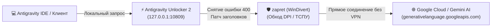

<div align="center">

# 🚀 FixNovaAntigravity

### Комплексный гайд и набор фиксов для запуска Google Antigravity без VPN
**zapret (DPI Bypass) + Antigravity Unlocker 2 (v2.23.1 / v2.24.0)**

[](https://microsoft.com)
[](https://t.me)
[](https://github.com/Flowseal/zapret-discord-youtube)
[](#)
[](#)

<p align="center">
  <b>Решение ошибки 400 ("User location is not supported"), вечного статуса Working, ошибки "Model is not available" и проблем со входом в Google аккаунт на полной скорости без VPN.</b>
</p>

[Быстрый старт](#-быстрый-старт-пошаговая-инструкция) •
[Настройки Unlocker 2](#2-настройка-antigravity-unlocker-2-v2231) •
[Фикс долгого Working](#-фикс-вечного-статуса-working-запросы-висят-по-15-минут) •
[Фикс Model is not available](#-фикс-ошибки-model-is-not-available-без-потери-контекста) •
[Диагностика](#-встроенные-утилиты-диагностики) •
[Полный гайд ошибок (FAQ)](TROUBLESHOOTING.md)

---

</div>

## 📌 Архитектура решения

Связка работает по принципу разделения задач:
1. **zapret** обходит ТСПУ/DPI провайдера на уровне сетевого стека Windows (через драйвер WinDivert), модифицируя TCP/TLS-пакеты к серверам Google.
2. **Antigravity Unlocker 2** нормализует заголовки, патчит проверки региона и снимает ошибку `400 Bad Request / Unsupported Location`.
3. **Antigravity** работает на максимальной скорости вашего интернет-канала без шифрованных туннелей VPN.



---

## ⚡ Главное правило: «Правило 3 процессов»

Для корректной работы на панели задач / в трее должны быть одновременно активны:
1. 🟢 **zapret** (служба или консольный процесс)
2. 🟢 **Antigravity Unlocker 2**
3. 🟢 Сам **Antigravity**

> [!IMPORTANT]
> **ПОЛНОСТЬЮ ОТКЛЮЧИТЕ ВСЕ VPN ПЕРЕД НАЧАЛОМ!**  
> Не запускайте WARP, WireGuard, OpenVPN, Amnezia или сторонние прокси-расширения в браузере. VPN перехватывает трафик до драйвера WinDivert и ломает обход DPI.

---

## 💡 Зачем zapret, если есть VPN?

В комьюнити часто возникает вопрос: *«Зачем возиться с zapret, если можно просто включить VPN?»*

| Характеристика | Обычный VPN | zapret + Antigravity Unlocker 2 |
| :--- | :--- | :--- |
| **Скорость генерации** | Занижена до 5–15 Мбит/с, долгий стриминг кода | **Максимальная скорость провайдера (до 1 Гбит/с)** |
| **Стабильность стриминга** | SSE-поток токенов регулярно зависает на 15–20 мин | Стабильный непрерывный поток ответа |
| **Блокировки по IP** | IP большинства коммерческих VPN уже внесены Google в блэклист | Трафик идет напрямую, без чужих заблокированных IP |
| **Цена** | Требуется платный качественный VPN | **Полностью бесплатно** |

---

## ⏳ Фикс вечного статуса "Working" (запросы висят по 15+ минут)

Многие пользователи сталкиваются с тем, что модель "думает по 15–20 минут" и не выдает ответ.

### Причины и мгновенный фикс:
1. **ВЫКЛЮЧИТЕ «Прокси из группы» в Antigravity Unlocker 2!**  
   Сервера группы периодически перегружаются сотнями людей («сервера кладут»), из-за чего ваши запросы стоят в бесконечной очереди. При выключенном пункте трафик идет напрямую через zapret без задержек.
2. **Включите в Unlocker «Ротация между серверами: ВКЛ» и «Встроенные выходы: ВКЛ».**
3. **Лайфхак "Раскачки стрима" из чата:**  
   Если ответ все же подвис на этапе *Working*, отправьте в поле ввода чата любое короткое сообщение (например `.` или `продолжай`) и нажмите Enter. Unlocker переинициализирует TCP-сокет, и генерация мгновенно продолжит идти с того же места.

---

## ⚠️ Фикс ошибки "Model is not available" без потери контекста

Если после запроса вылетает плашка `Model is not available`, **не создавайте новый чат**, чтобы не потерять контекст проекта:

1. **Смена модели:** В правом углу чата переключитесь на альтернативную модель (например, с *Gemini 3.8 Flash* на *Gemini 3.8 Pro* или *Flash Lite*), отправьте тестовое короткое слово и вернитесь обратно на основную модель.
2. **Рестарт Unlocker:** Закройте окно Antigravity Unlocker 2 и запустите его снова от имени Администратора (Antigravity при этом закрывать не нужно!). После этого нажмите в чате кнопку **Retry**.
3. **Метод "Прогрева сокета" (Тестовый Привет):** Откройте новый пустой чат, напишите туда короткое «Привет» или «Тест», дождитесь ответа модели, а затем вернитесь обратно в свой старый проектный чат. Сокет прогреется с чистыми заголовками, и основной диалог продолжит отвечать!
4. **Очистка старых сессий:** Если ошибка не уходит, закройте клиент и запустите скрипт `scripts\clear-antigravity-cache.bat` (аналог утилиты `antigravity-cleaner`).

---

## 💳 Проблема с аккаунтами: почему недоступен Argon?

Если вы приобрели аккаунт на маркетплейсах "за 200 рублей" и обнаружили, что модель **Argon (DeepMind Argon / Gemini 3.8 Advanced)** заблокирована:
- Такие аккаунты чаще всего создаются через индийский триал **Jio Free Plan**. Google стал ограничивать квоты и закрывать доступ к модели Argon для промо-планов Jio.
- Полный доступ к Argon без искусственных ограничений гарантирован на оригинальных подписках Google One AI Premium ($20/мес).

---

## 🚀 Быстрый старт (Пошаговая инструкция)

### Шаг 1. Настройка и запуск zapret

1. Скачайте актуальный релиз **zapret-discord-youtube**:
   - [Официальный репозиторий Flowseal](https://github.com/Flowseal/zapret-discord-youtube)
2. **Добавьте домены Google AI в список zapret (`list-general.txt`):**
   > [!IMPORTANT]
   > В стандартном списке zapret **НЕТ** доменов Google AI! Без них zapret не будет перехватывать и разблокировать запросы к Gemini.
   - **Вариант А (Автоматически в 1 клик):** запустите скрипт [`scripts/add-to-zapret.bat`](scripts/add-to-zapret.bat), укажите папку вашего zapret — скрипт сам сделает бэкап и бережно объединит домены без дубликатов.
   - **Вариант Б (Вручную):** откройте ваш файл `zapret\lists\list-general.txt`, скопируйте всё содержимое из нашего файла [`lists/list-general.txt`](lists/list-general.txt) и вставьте его **в самый конец** вашего файла.
3. Запустите файл `service.bat` **от имени Администратора** (ПКМ -> *Запуск от имени администратора*).
4. В появившемся меню выберите пункт **Run Tests** (или запуск тестов для подбора стратегии).
5. Дождитесь завершения тестирования — утилита автоматически определит самый стабильный и оптимальный **ALT-пресет** под вашего провайдера (например, `fake alt 3`, `ALT2` или `general`).
6. Примените выбранный пресет в качестве постоянной службы Windows или запустите соответствующий `.bat` файл.

> [!WARNING]
> **ОБЯЗАТЕЛЬНО ПЕРЕЗАПУСТИТЕ ZAPRET ПОСЛЕ РЕДАКТИРОВАНИЯ СПИСКА!**  
> zapret загружает файл `list-general.txt` в память **только в момент старта**. Если вы отредактировали список, пока zapret работал, закройте окно/службу и запустите её заново, иначе новые домены не вступят в силу.

---

### Шаг 2. Настройка Antigravity Unlocker 2 (v2.23.1 / v2.24.0)

Запустите **Antigravity Unlocker 2** (например, `AG_2.24.0.exe`) **от имени Администратора** и выставьте параметры строго в соответствии с таблицами:

#### 1. Проверка обнаруженных установок («Найденные установки Antigravity»):
В версии **2.24.0** Unlocker автоматически сканирует установленные клиенты:
- 🟢 **Antigravity 2.0** (`%LOCALAPPDATA%\Programs\antigravity`) — десктопный клиент нового поколения.
- 🟢 **Antigravity IDE** (`%LOCALAPPDATA%\Programs\Antigravity IDE`) — среда разработки на базе VS Code.
- ⚪ **Antigravity CLI** (`не найдено — укажите путь`) — консольный интерфейс `agy`. **Если вы не пользуетесь CLI из терминала, серый кружок ⚪ — это абсолютно нормально!** Ничего указывать не нужно, на работу 2.0 и IDE это не влияет.

#### 2. Основные параметры:
| Параметр | Значение | Описание |
| :--- | :---: | :--- |
| **Вход в аккаунт из-под санкций** | **ВКЛ** | Разрешает OAuth-авторизацию аккаунтов из РФ/РБ |
| **Снять ошибку 400 в чате с ИИ** | **ВКЛ** | Устраняет блокировку региона в ответах Gemini |
| **Прокси из группы** | **ВЫКЛ** | Исключает зависимость от перегруженных публичных прокси |
| **Автопатч** | **ВКЛ** | Автоматически внедряет необходимые сертификаты и хуки |

#### 3. Настройки для опытных (расширенные):
| Параметр | Значение | Описание |
| :--- | :---: | :--- |
| **Обход через DNS** | **ВКЛ** | Предотвращает спуфинг DNS со стороны провайдера |
| **Ротация между серверами** | **ВКЛ** | Распределяет нагрузку и обходит лимиты запросов |
| **Локальный прокси** | **ВЫКЛ** | Отключает лишний локальный форвардинг |
| **Встроенные выходы** | **ВКЛ** | Активирует внутренние оптимизированные маршруты |
| **Сверять TLS** | **ВКЛ** | Предотвращает разрыв соединений при проверке сертификатов |
| **Свой HTTP-прокси** | `https://127.0.0.1:10809` *(или пусто)* | См. важное примечание ниже |

> [!WARNING]
> **ПРИМЕЧАНИЕ ПО ПОЛЮ «СВОЙ HTTP-ПРОКСИ»:**  
> - Если у вас запущен собственный локальный туннель (Xray / v2ray / Clash / sing-box на порту 10809), укажите строго `https://127.0.0.1:10809`.  
> - **Если у вас НЕТ отдельного прокси-сервера:** **ОСТАВЬТЕ ЭТО ПОЛЕ ПУСТЫМ!** В противном случае Unlocker будет пытаться подключиться к несуществующему порту и выдаст ошибку `os error 10061 (Подключение отвергнуто)`. При пустом поле Unlocker работает через свои встроенные выходы напрямую с zapret.

---

### Шаг 3. Запуск и проверка Antigravity

1. Перезапустите приложение **Antigravity** (2.0 или IDE).
2. Убедитесь, что в трее активны и `zapret`, и `Antigravity Unlocker 2`.
3. Откройте чат с ИИ и отправьте тестовое сообщение.
4. Ответ модели должен приходить быстро, без ожидания и без ошибок 400/403.

---

## 🧰 Встроенные утилиты диагностики и ремонта

В папку [`scripts/`](scripts/) включены вспомогательные скрипты:

- [`scripts/add-to-zapret.bat`](scripts/add-to-zapret.bat) — автоматическое и безопасное добавление доменов Google AI в ваш существующий `list-general.txt` без удаления ваших сайтов (Discord, YouTube) и без дубликатов.
- [`scripts/fix-unlocker-service.bat`](scripts/fix-unlocker-service.bat) — принудительный перезапуск зависшей службы обхода (`ag_dns`), если кнопка «Починить» в Unlocker не срабатывает.
- [`scripts/clear-antigravity-cache.bat`](scripts/clear-antigravity-cache.bat) — умная очистка с выбором режима:
  - **Режим [1] (Безопасный):** устраняет черный экран (`GPUCache`), завершает зависшие `language_server.exe` и `ag_dns.exe` **БЕЗ разлогина и БЕЗ потери истории чатов**!
  - **Режим [2] (Полный сброс):** удаляет битые токены авторизации и сессии (требуется повторный логин в Google), если аккаунт намертво заблокирован ошибкой 400.
- [`scripts/check-ports.bat`](scripts/check-ports.bat) — экспресс-проверка готовности системы:
  - Запущен ли процесс `winws.exe` (zapret);
  - Статус `ag_dns.exe` и `language_server.exe`;
  - Проверка порта `10809` и предупреждение об `os error 10061`;
  - Не остались ли включенными фоновые VPN-адаптеры (WireGuard, TUN, WARP);
  - Доступность DNS для серверов `generativelanguage.googleapis.com`.

---

## ❓ Что делать, если все еще не работает?

👉 **Полное руководство со всеми редкими кейсами доступно в файле: [TROUBLESHOOTING.md](TROUBLESHOOTING.md)**:
- Ошибка в новых чатах `Unknown: Agent execution terminated due to error` (зависший `language_server.exe`);
- Сбой кнопки «Починить» в Unlocker (`ag_dns`);
- Черный экран при запуске Antigravity;
- Ошибки `os error 10061` и почему упала группа Nova (404 на `cloudcode-pa`);
- Ошибки `WinDivert (code 5 / 1753)` и конфликты с античитами (Vanguard / FaceIT);
- Настройка шифрованного DoH (DNS over HTTPS) в Windows.

---

## 📂 Структура репозитория

```text
FixNovaAntigravity/
├── README.md                      # Главное руководство пользователя
├── TROUBLESHOOTING.md             # Расширенное решение ошибок и проблем
├── lists/
│   ├── list-general.txt           # Базовый список доменов (Google AI, Cloudflare, DoH)
│   └── list-extended.txt          # Расширенный список (включая Google OAuth, CloudCode)
└── scripts/
    ├── add-to-zapret.bat          # Добавление доменов в zapret без дубликатов
    ├── check-ports.bat            # Скрипт проверки сети, портов и процессов
    ├── clear-antigravity-cache.bat # Полная очистка кэша, сессий и зависших процессов
    └── fix-unlocker-service.bat   # Принудительный перезапуск зависшей службы ag_dns
```

---

## 💎 Поддержка проекта (Donations)

Если этот проект экономит ваше время и делает работу с Antigravity комфортнее, вы можете поддержать автора:

- **TON (The Open Network) / USDT (TON):**
  ```text
  UQAjHHEZOrKhrbt3aeQT9Xm3kHt2Xeo3Pnz3ok6HhR8OYzn-
  ```

---

## ⚖️ Дисклеймер
Проект создан исключительно в ознакомительных и образовательных целях для обеспечения стабильности среды разработки. Все права на сторонние компоненты принадлежат их законным авторам.
