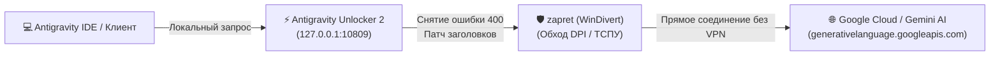

<div align="center">

# 🚀 FixNovaAntigravity

### Комплексный гайд и набор фиксов для запуска Google Antigravity без VPN
**zapret (DPI Bypass) + Antigravity Unlocker 2 (v2.23.1)**

[](https://microsoft.com)
[](https://t.me)
[](https://github.com/Flowseal/zapret-discord-youtube)
[](#)
[](#)

<p align="center">
  <b>Решение ошибки 400 ("User location is not supported"), проблем со входом в Google аккаунт и блокировок DPI без использования медленных или платных VPN.</b>
</p>

[Быстрый старт](#-быстрый-старт-пошаговая-инструкция) •
[Настройки Unlocker 2](#2-настройка-antigravity-unlocker-2-v2231) •
[Диагностика](#-встроенные-утилиты-диагностики) •
[Что делать, если не работает?](TROUBLESHOOTING.md)

---

</div>

## 📌 Архитектура решения

Связка работает по принципу разделения задач:
1. **zapret** обходит ТСПУ/DPI провайдера на уровне сетевого стека Windows (через драйвер WinDivert), модифицируя TCP/TLS-пакеты к серверам Google.
2. **Antigravity Unlocker 2** нормализует заголовки, патчит проверки региона и снимает ошибку `400 Bad Request / Unsupported Location`.
3. **Antigravity** работает на максимальной скорости вашего интернет-канала без шифрованных туннелей VPN.



---

## ⚡ Главное правило: «Правило 3 процессов»

Для корректной работы на панели задач / в трее должны быть одновременно активны:
1. 🟢 **zapret** (служба или консольный процесс)
2. 🟢 **Antigravity Unlocker 2**
3. 🟢 Сам **Antigravity**

> [!IMPORTANT]
> **ПОЛНОСТЬЮ ОТКЛЮЧИТЕ ВСЕ VPN ПЕРЕД НАЧАЛОМ!**  
> Не запускайте WARP, WireGuard, OpenVPN, Amnezia или сторонние прокси-расширения в браузере. VPN перехватывает трафик до драйвера WinDivert и ломает обход DPI.

---

## 🚀 Быстрый старт (Пошаговая инструкция)

### Шаг 1. Настройка и запуск zapret

1. Скачайте актуальный релиз **zapret-discord-youtube**:
   - [Официальный репозиторий Flowseal](https://github.com/Flowseal/zapret-discord-youtube)
2. Замените или дополните файл списка доменов `list-general.txt` в папке zapret:
   - Возьмите готовый список из нашего репозитория: [`lists/list-general.txt`](lists/list-general.txt) (или расширенный [`lists/list-extended.txt`](lists/list-extended.txt)).
3. Запустите файл `service.bat` **от имени Администратора** (ПКМ -> *Запуск от имени администратора*).
4. В появившемся меню выберите пункт **Run Tests** (или запуск тестов для подбора стратегии).
5. Дождитесь завершения тестирования — утилита автоматически определит самый стабильный и оптимальный **ALT-пресет** под вашего провайдера.
6. Примените выбранный пресет в качестве постоянной службы Windows или запустите соответствующий `.bat` файл.

---

### Шаг 2. Настройка Antigravity Unlocker 2 (v2.23.1)

Откройте **Antigravity Unlocker 2** и выставьте параметры строго в соответствии с таблицами:

#### Основные параметры:
| Параметр | Значение | Описание |
| :--- | :---: | :--- |
| **Вход в аккаунт из-под санкций** | **ВКЛ** | Разрешает OAuth-авторизацию аккаунтов из РФ/РБ |
| **Снять ошибку 400 в чате с ИИ** | **ВКЛ** | Устраняет блокировку региона в ответах Gemini |
| **Прокси из группы** | **ВЫКЛ** | Исключает зависимость от перегруженных публичных прокси |
| **Автопатч** | **ВКЛ** | Автоматически внедряет необходимые сертификаты и хуки |

#### Настройки для опытных (расширенные):
| Параметр | Значение | Описание |
| :--- | :---: | :--- |
| **Обход через DNS** | **ВКЛ** | Предотвращает спуфинг DNS со стороны провайдера |
| **Ротация между серверами** | **ВКЛ** | Распределяет нагрузку и обходит лимиты запросов |
| **Локальный прокси** | **ВЫКЛ** | Отключает лишний локальный форвардинг |
| **Встроенные выходы** | **ВКЛ** | Активирует внутренние оптимизированные маршруты |
| **Сверять TLS** | **ВКЛ** | Предотвращает разрыв соединений при проверке сертификатов |
| **Свой HTTP-прокси** | `https://127.0.0.1:10809` | Локальная конечная точка проксирования |

> [!WARNING]
> Обратите внимание на протокол `https://` в поле своего прокси: строка должна иметь вид: `https://127.0.0.1:10809`.

---

### Шаг 3. Запуск и проверка Antigravity

1. Перезапустите приложение **Antigravity**.
2. Убедитесь, что в трее активны и `zapret`, и `Antigravity Unlocker 2`.
3. Откройте чат с ИИ и отправьте тестовое сообщение.
4. Ответ модели должен приходить быстро, без ожидания и без ошибок 400/403.

---

## 🧰 Встроенные утилиты диагностики

В папку [`scripts/`](scripts/) включены вспомогательные скрипты:

- [`scripts/check-ports.bat`](scripts/check-ports.bat) — экспресс-проверка:
  - Запущен ли процесс `winws.exe` (zapret);
  - Слушается ли порт `10809`;
  - Не остались ли включенными фоновые VPN-адаптеры (WireGuard, TUN, WARP);
  - Доступность DNS для серверов `generativelanguage.googleapis.com`.
- [`scripts/clear-antigravity-cache.bat`](scripts/clear-antigravity-cache.bat) — сброс кэша и старых токенов авторизации Antigravity, если клиент "застрял" на старой региональной блокировке.

---

## ❓ Что делать, если не работает?

Если после всех настроек вы сталкиваетесь с ошибками:
- `Failed to open WinDivert device`
- Ошибка `400 Bad Request / Unsupported Location`
- Не удается авторизоваться через Google
- `ECONNREFUSED 127.0.0.1:10809`
- Блокировки со стороны антивирусов / Защитника Windows

👉 **Перейдите в подробный гайд: [TROUBLESHOOTING.md](TROUBLESHOOTING.md)**, где детально описаны решения всех возможных проблем для различных интернет-провайдеров.

---

## 📂 Структура репозитория

```text
FixNovaAntigravity/
├── README.md                      # Главное руководство пользователя
├── TROUBLESHOOTING.md             # Расширенное решение ошибок и проблем
├── lists/
│   ├── list-general.txt           # Базовый список доменов (Google AI, Cloudflare, DoH)
│   └── list-extended.txt          # Расширенный список (включая Google OAuth, CloudCode)
└── scripts/
    ├── check-ports.bat            # Скрипт проверки сети и портов
    └── clear-antigravity-cache.bat # Скрипт безопасной очистки кэша клиента
```

---

## ⚖️ Дисклеймер
Проект создан исключительно в ознакомительных и образовательных целях для обеспечения совместимости и стабильности среды разработки. Все права на сторонние компоненты принадлежат их авторам.
