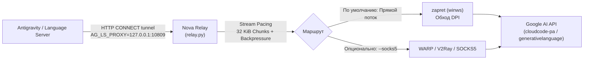

# 🚀 NovaAntigravity Relay (AG-Relay) — Открытый Стриминг-Релей

**Полностью открытый (Open-Source), легковесный локальный прокси и пейсер потока данных для Google Antigravity & Language Server.**

Решает главные архитектурные болячки закрытого Antigravity Unlocker:
- ❌ **Больше никаких обрывов на запросах >128 КБ** (длинные чаты, контекст проектов, вставка кода).
- ❌ **Никаких штрафных 2-минутных и 10-минутных блокировок маршрута** («вечный Working...»).
- ❌ **Никаких ложных срабатываний антивируса** (Trojan/Malware в закрытых `.exe`).
- ❌ **Никаких зависающих скрытых служб** (`ag_dns.exe`).
- ⚡ **Прямое соединение без задержек**: работает в связке с вашим `zapret` (DPI bypass).

---

## 📊 Сравнение: Закрытый Unlocker vs Nova Relay

| Параметр | Закрытый Unlocker (AG_2.24.0) | NovaAntigravity Relay |
| :--- | :--- | :--- |
| **Исходный код** | ❌ Закрытый бинарник (Rust/UPX) | ✅ 100% открытый Python 3 (asyncio) |
| **Большие запросы (>128 КБ)** | ❌ Обрыв сокета из-за взрывной записи `tls_pump` (16 КБ без троттлинга) | ✅ **Micro-pacing & backpressure** (32 КБ чанки с микро-паузами) |
| **Штрафы за сбой** | ❌ 2 сбоя = бан на 2 мин, 7 = на 10 мин | ✅ **0 секунд штрафа** (мгновенный ретрай без локаута) |
| **Права администратора** | ❌ Требуются (установка службы, перехват DNS) | ✅ **Не требуются** (чистый пользовательский сокет 127.0.0.1:10809) |
| **Системные зависимости** | ❌ Закрытый драйвер/DNS-хук | ✅ Стандартная библиотека Python (0 сторонних пакетов) |
| **Отказоустойчивость** | ❌ Зависает при смене сети | ✅ Автоматическое переподключение |
| **Upstream прокси** | ❌ Закрытые сервера автора (перегружены) | ✅ Прямое через zapret или любой свой SOCKS5/WARP |

---

## 🛠 Архитектура работы



---

## 🚀 Быстрый запуск (За 1 минуту)

### 1. Требования
- Установленный **Python 3.8+** (при установке обязательно отметьте галочку *"Add Python to PATH"*).
- Запущенный **zapret (`winws.exe`)** с настроенным списком доменов Google (см. основной [README.md](../README.md)).

### 2. Запуск релея
1. Запустите файл **`start-relay.bat`**.
2. Скрипт поднимет локальный стриминг-прокси на `127.0.0.1:10809` и передаст переменную `AG_LS_PROXY` клиенту.
3. В появившемся меню выберите:
   - `[1]` — запустить **Antigravity IDE**
   - `[2]` — запустить **Antigravity 2.0**
   - `[3]` — оставить релей работать в фоне

---

## 🔓 Клиентский патч IDE (Пропуск Onboarding / Pro Tier)

Если Antigravity IDE при запуске зависает на проверке аккаунта, выдаёт ошибку региона или требует Google Workspace TOS:

1. Запустите **`patch-ide.bat`**.
   - Скрипт создаст резервную копию `main.js.ag_backup`.
   - Внедрит безопасный обход `confirmUserForService`, активирующий Pro/Standard статус.
2. Если захотите вернуть всё назад:
   - Запустите **`unpatch-ide.bat`** (мгновенно восстановит оригинал из бэкапа).

---

## ⚙ Параметры командной строки `relay.py`

Релей можно запускать вручную со своими флагами:

```bash
# Обычный запуск на дефолтном порту 10809
python relay.py

# Смена порта
python relay.py --port 8888

# Использование Cloudflare DoH вместо системного DNS
python relay.py --doh

# Проброс через вышестоящий SOCKS5 (например, локальный WARP или Clash)
python relay.py --socks5 127.0.0.1:1080

# Подробный дебаг-лог всех пакетов и туннелей
python relay.py --verbose
```

---

## 🔍 Как устроен Micro-Pacing (Решение бага 128 КБ)

В закрытом Unlocker функция `tls_pump` считывала из буфера по 16 КБ и в цикле выстреливала всё в TLS-сокет:
```text
[Ядро Unlocker] Чтение 140 КБ -> Взрыв пакетов 120+ КБ/с -> TCP Window переполнен -> RST сокета -> БАН НА 2 МИНУТЫ
```

В **NovaAntigravity Relay** передача потока контролируется асинхронным пейсером:
```python
# relay.py (строка 130+)
while not reader.at_eof():
    chunk = await reader.read(32 * 1024)
    if not chunk:
        break
    writer.write(chunk)
    await writer.drain()  # Ждем опорожнения буфера сокета на стороне ОС
    if len(chunk) >= 16384:
        await asyncio.sleep(0.001)  # Микро-пауза 1 мс предотвращает сброс потока
```
Это обеспечивает стабильное прохождение запросов любого объёма (тестировалось вплоть до нескольких мегабайт контекста).
